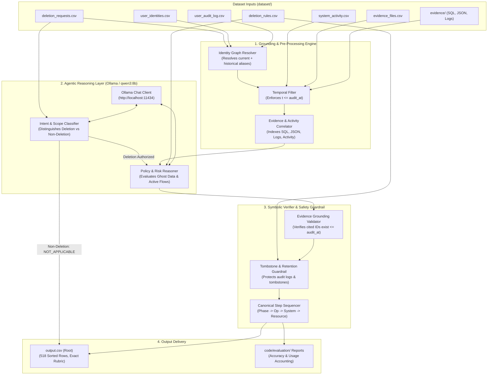
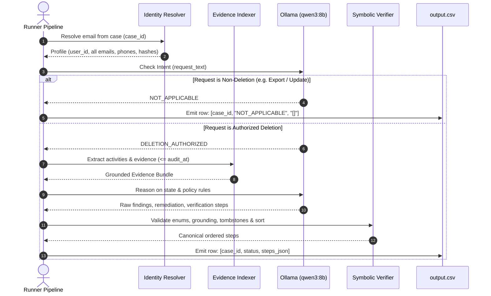

# Architecture: Ghost Data Still Exists AI Deletion-Audit Agent

## 1. Architectural Philosophy: The Hybrid Deterministic-Agentic Model

Auditing deletion compliance in regulated environments requires zero tolerance for hallucinations, invalid schema states, or non-deterministic ordering. While Large Language Models (LLMs) excel at multilingual natural language intent classification and unstructured evidence interpretation, they cannot be solely relied upon for strict JSON sorting, relational integrity, or temporal boundary validation.

Our architecture adopts a **Hybrid Deterministic-Agentic Architecture**:
1. **Deterministic Grounding Layer (Symbolic Subsystem):** Pre-processes structured files, resolves complex multi-alias identity graphs, parses SQL replicas and JSON exports, and strictly enforces the temporal boundary ($t \le \text{audit\_at}$).
2. **Agentic Reasoning Layer (`qwen3:8b` via Ollama Chat Interface):** Performs semantic intent classification on customer request texts and reasons over complex cross-system policy interactions.
3. **Deterministic Constraint Solver & Sequencer (Symbolic Guardrail):** Validates all proposed findings and remediation actions against `deletion_rules.csv`, ensures evidence IDs exist in participant-visible files, strips hallucinated references, and applies the canonical sort algorithm.

---

## 2. High-Level Architecture Diagram

---

## 3. Core Component Architecture

### 3.1 Identity Graph Resolver (`IdentityResolver`)
- **Inputs:** `user_identities.csv`, `user_audit_log.csv`.
- **Function:** Builds a bi-directional graph mapping any customer email (current or historical), phone number (current or historical), customer name, or email hash to a unique `user_id`.
- **Safety Guarantee:** Avoids missed ghost data when a user changes their email or phone prior to requesting deletion.

### 3.2 Evidence & Activity Indexer (`EvidenceEngine`)
- **Inputs:** `system_activity.csv`, `evidence_files.csv`, and files under `dataset/evidence/`.
- **Temporal Gating:** Ignores any activity or evidence item with `timestamp > audit_at`.
- **Multi-Modal Evidence Adapters:**
  - *SQL Adapter:* Parses SQLite-compatible dumps (`customer_data_inventory_*.sql`, `customer_accounts_failover_replica_*.sql`, `customer_search_primary_*.sql`) to inspect table states.
  - *JSON Adapter:* Parses snapshot bundles (`service_resource_export_*.json`, `customer_data_snapshot_bundle_*.json`) for exact `status_code`, `observed_at`, and entity payloads.
  - *Log Adapter:* Scans observability logs for service trace events, connector synchronization syncs, and replica errors.

### 3.3 Ollama Chat Client & Model Orchestrator (`OllamaAgent`)
- **Connection Configuration:**
  - Base URL: `http://localhost:11434`
  - Endpoint: `/api/chat`
  - Model: `qwen3:8b`
  - Format: `json`
- **Resilience Engineering:**
  - Request timeout (default: 60s).
  - Exponential backoff retry on connection errors or transient failures (up to 3 attempts).
  - Token tracking for `code/evaluation/usage_report.md`.
- **Dual-Prompt Specialization:**
  1. **Intent Prompt:** Multi-lingual few-shot prompt to classify non-deletion requests (data portability, invoice request, marketing opt-out, contact information updates).
  2. **Audit Prompt:** Structured prompt presenting resolved customer identifiers, relevant activity claims, and grounded evidence snippets to decide whether deletion is `COMPLETE` or `INCOMPLETE`.

### 3.4 Deterministic Post-Processor & Canonical Sequencer (`StepSequencer`)
- **Schema & Enum Sanitizer:** Ensures every generated operation is strictly within the 16 allowed operations defined in the problem statement.
- **Evidence Reference Enforcer:**
  - For `COMPLETE` verification steps: ensures cited `evidence_id` exists and is timestamped $\le \text{audit\_at}$.
  - For `INCOMPLETE` findings: ensures valid `evidence_id`.
  - For `INCOMPLETE` remediation & post-verification: guarantees `evidence_id == ""`.
- **Canonical Sorter:**
  Enforces:
  $$\text{Phase Precedence} \to \text{Operation Order} \to \text{system\_id ASC} \to \text{resource\_id ASC}$$
  Re-indexes all `step_no` consecutively starting from `1`.

---

## 4. End-to-End Case Execution Sequence

---

## 5. Technology Stack & Runtime Dependencies
- **Runtime Environment:** Python 3.10+ (Current: Python 3.13 in `venv`)
- **LLM Engine:** Ollama running locally on Windows (`http://localhost:11434`) with `qwen3:8b`
- **Standard Library Only for Production Core:** `csv`, `json`, `urllib` / `requests`, `re`, `pathlib`, `sqlite3`, `dataclasses`.
- **Testing & Verification:** Python `unittest` / pytest benchmark suite in `code/evaluation/main.py`.
